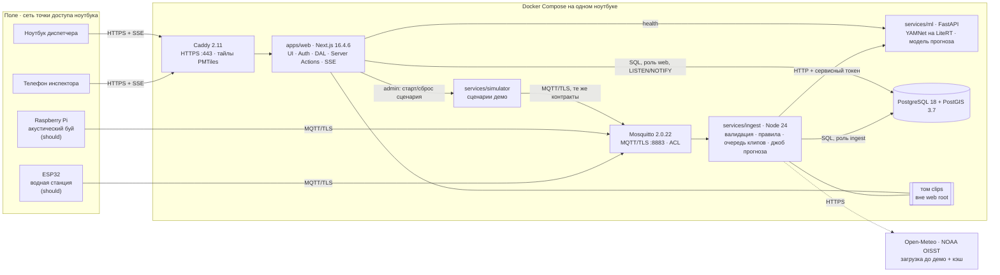
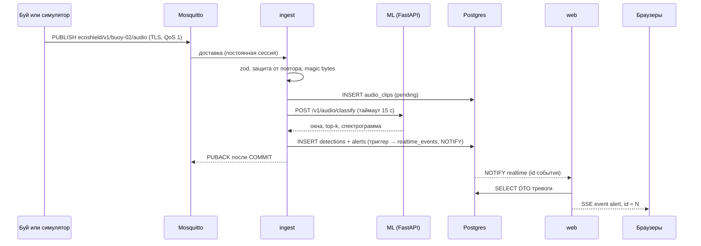
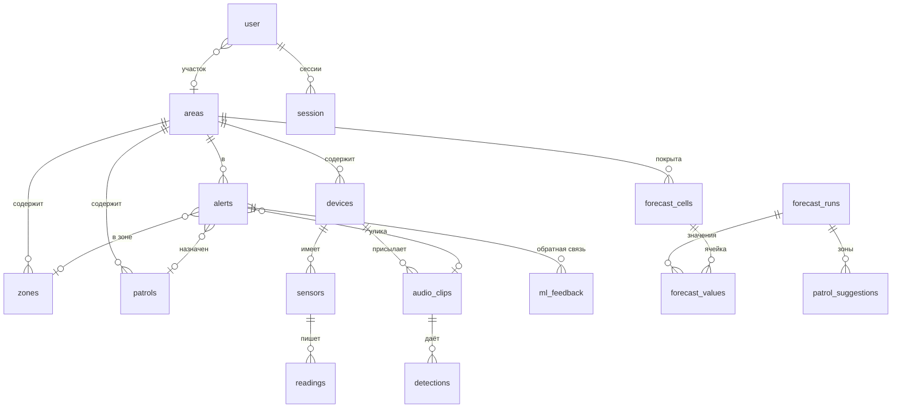

# Эко-щит Каспия — план MVP (Фаза 0)

> Статус: **утверждён с изменениями** · 12.11.2026 · кейс 1 «Эко-щит Каспия», трек 1
> План работ для одного разработчика — §18, Git и ревью — §19, источники — §20.
> Документы — на русском; код, идентификаторы, комментарии и коммиты — на английском.
> Всё, что помечено «проверено», я проверил командами 12.11.2026 (вывод — в отчёте по Фазе 0).
> Всё, что помечено «допущение», нужно подтвердить или поправить.

## 0. Коротко

- **Что строим.** Веб-платформу «цифровой помощник инспектора ООПТ». В ней карта с живым статусом датчиков, лента тревог с полным жизненным циклом, ИИ-анализ звука (мотор лодки / выстрел), прогноз присутствия каспийского тюленя на 7 дней с зонами патрулирования и сценарный симулятор для демо. Всё запускается одной командой.
- **Территория:** федеральный заказник «Аграханский» (Дагестан). Граница взята из OpenStreetMap (`way/505346049`, проверено).
- **Прогноз:** каспийский тюлень, осенняя миграция — ровно в даты демо (§7).
- **Архитектура:** модульный монолит Next.js 16.4.6 + ML-сервис FastAPI + воркер `ingest` + PostgreSQL 18/PostGIS 3.7 + Mosquitto (MQTT/TLS) + Caddy (HTTPS в локальной сети для телефона).
- **Демо не зависит от Wi-Fi площадки.** Ноутбук раздаёт свою точку доступа (адаптер поддерживает режим AP — проверено). Тайлы, шрифты, модель и данные лежат локально. Внешние данные для прогноза кэшируются заранее.

## 1. Окружение (проверено 12.11.2026)

| Инструмент | Состояние | Что сделать |
|---|---|---|
| ОС / железо | Fedora 44, x86_64, 10 ядер, 30 ГБ ОЗУ, 289 ГБ свободно | — |
| git | 2.55.0, `user.name`/`user.email` заданы | — |
| Репозиторий | на момент Фазы 0 — пустой. Сейчас: `origin` = приватный GitHub-репозиторий, `main` = `f3e2ccb`. Учётных данных для `git push` на ноутбуке нет: нет credential helper и `gh` | `gh auth login` + `gh auth setup-git` (§19) |
| Docker | CLI 29.8.1, Compose v5.5.1, **демон остановлен, сервис отключён** | `sudo systemctl enable --now docker`, пользователя — в группу `docker` |
| Podman | 5.8.4 | запасной вариант |
| Node.js / npm / corepack | ✅ установлен Node 24.22.3 (npm 11.19.1) в `~/.local`, sha256 сверен с SHASUMS256 | — |
| pnpm | ✅ 12.18.0 в `~/.local`. Пропущенные build-скрипты зависимостей pnpm 12 считает ошибкой; решения хранятся в `pnpm-workspace.yaml` → `allowBuilds` | — |
| Python | 3.14.7 (системный) | ML-сервис — Python 3.13 в Docker; локально `uv python install 3.13` |
| uv | ✅ 0.13.7 в `~/.local/bin`, sha256 сверен | — |
| gh | **нет** | нужен для PR и настройки правил `main` |
| gitleaks, lefthook | нет | lefthook ставится через pnpm; gitleaks — бинарник или Docker-образ |
| openssl / jq | 3.5.8 / 1.8.1 | ок (локальный CA сгенерируем через openssl) |
| PlatformIO / arduino-cli | нет | нужен только для ESP32 (should-have) |
| Wi-Fi `wlp0s20f3` | режим AP: да; 2.4 и 5 ГГц | точка доступа для демо |

## 2. Версии ключевых пакетов (проверены в npm, PyPI, Docker Hub)

| Компонент | Версия | Примечание |
|---|---|---|
| next / eslint-config-next | **16.4.6** | Advisories для `>=16.0.0 <=16.4.0` подтверждены: GHSA-673q-mjm6-r5xr (RCE через `use cache`), GHSA-2464-fhr4-w9xw (RCE через SVG в Image Optimization), GHSA-p3m5-59mp-jv5r (DoS через Server Actions). 16.4.6 чистая. |
| sharp (транзитивно) | 0.35.5 | `<0.35.5` уязвим (GHSA-wq5f-xc86-pv6w, librsvg); next 16.4.6 требует `^0.35.5` |
| react / react-dom | 19.3.1 | |
| typescript | **6.0.3** (не 7.0.2) | typescript-eslint 8.72.2 из eslint-config-next требует `typescript >=4.8.4 <6.1.0` |
| Node.js | **24.22.3 LTS** | Node 26 — активный LTS, но 24 ставится из dnf, поддерживается до 04.2028 и указан в `engines` у vitest |
| pnpm | 12.18.0 | перед настройкой прочитать release notes 11/12 |
| better-auth | 1.7.22 | проверено по типам: `password.hash/verify`, `disableSignUp`, `rateLimit.storage: "database"`, `useSecureCookies`, `telemetry.enabled` (по умолчанию `false`) |
| drizzle-orm / drizzle-kit | 0.45.4 / 0.31.11 | стабильные (1.0 пока rc) |
| pg | 8.23.1 | |
| zod | 4.6.7 | |
| maplibre-gl | **6.18.0** | мажорная версия 6: API сверяем с документацией при установке |
| pmtiles / @protomaps/basemaps | 4.5.0 / 5.7.2 | go-pmtiles CLI v1.31.2 — для вырезки района |
| tailwindcss / shadcn (CLI) / radix-ui | 4.3.5 / 4.23.0 / 1.8.1 | |
| vitest / @playwright/test / lighthouse | 5.1.0 / 1.65.0 / 13.6.0 | |
| PostgreSQL / PostGIS | 18.6 / 3.7 (`postgis/postgis:18-3.7`) | образ **только amd64** (риск R7) |
| Mosquitto / Caddy | `eclipse-mosquitto:2.0.22` / `caddy:2.11.9-alpine` | |
| Python-стек ML | fastapi 0.162.5, uvicorn 0.54.0, pydantic 2.14.3, numpy 2.5.4, ai-edge-litert 2.3.0, soundfile 0.14.0, soxr 1.1.0, pillow 13.0.0, scikit-learn 1.9.1 | Python 3.13: у TF 2.21 нет колёс под 3.14; у LiteRT есть колёса aarch64 для RPi |

**Что изменилось в Next.js 16.x.** Всё ниже я прочитал во встроенной документации 16.4.6 (`node_modules/next/dist/docs`):

- `middleware.ts` → `proxy.ts`.
- `next lint` удалён, вместо него ESLint CLI.
- Анализатор бандлов для Turbopack: `next analyze` (с 16.1), `next analyze export` (с 16.4).
- Cache Components включается флагом `cacheComponents: true` вместе с `partialPrefetching: true`. В «рекомендуемых настройках» `create-next-app` 16.4 он включён — отсюда «по умолчанию для новых приложений».
- `export const instant = false` помечает сегмент, которому разрешено блокировать рендер.

## 3. Допущения

| # | Допущение | Если неверно |
|---|---|---|
| A1 | Разработчик один — ИИ-агент: весь код, конфигурация, миграции, прошивки, тесты и документы. Пятеро людей не пишут код. Они ревьюеры по трекам P/W/M/H/D и делают то, что агент физически не может: sudo, настройки GitHub, железо, сертификат на телефоне, запись звука, репетиции. Агент может запускать суб-агентов в отдельных git worktree и сам интегрирует их работу. Бюджет — около 48 ч от согласования плана; дата и время демо не подтверждены. | Пересчитаю §18 |
| A2 | Демо-ноутбук — эта машина (Fedora, x86_64) | Проверить архитектуру: для ARM нужен другой образ PostGIS (R7) |
| A3 | Сеть на демо — точка доступа ноутбука (NetworkManager, обычно 10.42.0.1). Интернет нужен только до демо: сборка образов и кэш данных. | Площадочный Wi-Fi остаётся запасным вариантом |
| A4 | Телефон открывает веб по HTTPS через Caddy. Сертификат выпускает наш локальный CA, корневой сертификат заранее ставится на телефон. | Запасной вариант — мобильная вёрстка в окне 375 px на ноутбуке (R1) |
| A5 | Территория — заказник «Аграханский» плюс иллюстративная морская операционная зона вокруг Аграханского п-ова. Зоны режима — **демонстрационные**, юридический статус не утверждаем. | Поменять полигон сида |
| A6 | Прогноз — присутствие каспийского тюленя, не нерест рыб | §7 |
| A7 | «Акустический буй» — надводный буй с воздушным микрофоном: модели AudioSet обучены на воздушном звуке. Гидрофоны — вне рамок. | Нужны другие данные и модель |
| A8 | Персональных данных реальных людей нет. Демо-пользователи вымышленные. | — |
| A9 | Документация на русском | Переведём ARCHITECTURE/SECURITY/MODEL_CARD |

**Открытые вопросы:**
- дата и время демо (реальный бюджет часов);
- решение по сокращениям C1–C10 из §18;
- GitHub-логины ревьюеров для CODEOWNERS (§19);
- модель демо-телефона (iOS или Android) для docs/DEMO_DEVICE_SETUP.md;
- модели датчиков, Raspberry Pi и микрофона — не блокирует: пока железа нет, данные идут из симулятора.

## 4. Рамки

**Must.**
- Дашборд инспектора: карта со слоями, лента тревог, карточка тревоги, жизненный цикл.
- Аудио-ИИ: загрузка файла и поток от буя.
- Прогноз со слоем на карте и объяснением.
- Аутентификация с ролями на сервере.
- Симулятор сценариев.
- Запуск одной командой с сидом.

**Should.**
- ESP32 с датчиками воды по MQTT/TLS.
- RPi-буй с инференсом на краю.
- Английская локаль.
- PWA и индикатор устаревших данных.

**Could** — только после всего остального: спутниковый модуль (Sentinel-1/2), AR.

**Вне рамок:** платежи, чат, соцфункции, микросервис на каждую фичу, Kubernetes, Redis (обоснование в §5.4).

## 5. Архитектура

### 5.1 Схема



### 5.2 Путь тревоги и бюджет задержки (цель ≤ 3 с, ожидание ~1 с — измерим)



Гарантии доставки:

- `ingest` подтверждает сообщение MQTT только после коммита в БД (QoS 1, постоянная сессия). Обработка идемпотентна по `(device_id, boot_id, seq)`.
- Браузер переподключается к SSE с `Last-Event-ID`, и сервер досылает пропущенное из `realtime_events`.
- Если ML недоступен, клип встаёт в очередь, а тревога «неклассифицированное акустическое событие» создаётся сразу.

Итог: ни одно событие не теряется молча.

### 5.3 Структура репозитория и границы модулей

```
apps/web/                  Next.js (TS strict)
  src/app/                 тонкие маршруты: только композиция фич
  src/features/{alerts,sensors,forecast,audio,auth,audit,map,realtime,demo}/
      components/          UI фичи (client — только листья: карта, плеер, графики, формы)
      server/              queries.ts, actions.ts ('use server'), *.ts с import 'server-only'
      schemas.ts, dto.ts   zod-входы и минимальные DTO наружу
      index.ts             публичный API фичи (другие фичи импортируют только его)
  src/server/              db.ts, env.ts, dal.ts, authz.ts, errors.ts, logger.ts, ml-client.ts
  src/ui/                  токены и примитивы дизайн-системы
  src/i18n/                ru.ts, en.ts, format.ts (Intl, Europe/Moscow)
  src/proxy.ts             nonce-CSP, заголовки, оптимистичный редирект на /login
  src/instrumentation.ts   валидация env на старте, запуск LISTEN
services/ml/               FastAPI, uv, Python 3.13: audio/, forecast/, api/, tests/
services/ingest/           Node 24 + TS: mqtt/, rules/, clips/, forecast-job/, health
services/simulator/        Node 24 + TS: scenarios/*.json, publisher, control API (только внутренняя сеть)
packages/contracts/        zod-схемы: MQTT-сообщения, DTO, SSE-события; сгенерированные типы ML API
packages/db/               Drizzle-схема, SQL-миграции (роли, триггеры, PostGIS), сид
firmware/esp32/            PlatformIO (should)
edge/rpi/                  Python-агент буя (should)
infra/                     docker-compose.yml, Caddyfile, mosquitto/{conf,acl}, Dockerfile-ы
scripts/                   up.sh, gen-certs.sh, gen-device-creds.sh, fetch-data.sh (с sha256)
data/                      (в .gitignore) датасеты, клипы, модель, PMTiles; в git — только манифесты с чексуммами
docs/
compose.yaml               в корне: include infra/docker-compose.yml → `docker compose up` из корня
```

Правила границ:

- `features/*/server/**` импортирует `server-only`.
- Фича не лезет во внутренности другой фичи. ESLint `no-restricted-imports` пропускает только `features/x/index.ts`.
- Файлы в `app/` только вызывают фичи.

### 5.4 Ключевые решения

- **`ingest` на TypeScript (Node 24), не на Python.**
  - Схемы MQTT-сообщений описываются один раз в `packages/contracts` (zod). Их же используют симулятор и веб.
  - Три сервиса из четырёх на одном языке — меньше переключений для команды.
  - Клиенту `mqtt` 5.x можно отложить подтверждение сообщения до коммита в БД.
  - Воркер заодно ведёт фоновые задачи: очередь клипов с повтором при недоступном ML, джоб прогноза (раз в 6 ч и по запросу), детектор «устройство офлайн». Ещё один сервис ради них не нужен.
- **ORM — Drizzle**, драйвер `pg`.
  - SQL-подобный типизированный API без отдельного движка. У Prisma есть бинарный движок и слабая поддержка PostGIS.
  - Точки — встроенный тип `geometry`. Полигоны — `customType` и параметризованный `sql\`ST_GeomFromGeoJSON(${...})\``.
  - Миграции — обычные `.sql`, их удобно ревьюить. Роли, триггеры и NOTIFY пишем руками в SQL-миграциях.
- **Реальное время: LISTEN/NOTIFY + outbox `realtime_events` + SSE**, без Redis.
  - Экземпляр веба один, источник истины — БД.
  - В NOTIFY уходит только id: лимит полезной нагрузки 8000 байт, и так не утекают данные.
  - Redis понадобился бы для веерной рассылки между несколькими экземплярами, а у нас такого нет.
- **Caddy перед Next.js.**
  - Телефону нужен HTTPS: без него не работают `Secure`-cookie, геолокация и PWA.
  - Caddy отдаёт PMTiles с Range-запросами и не буферизует `text/event-stream`.
  - Один локальный CA (`scripts/gen-certs.sh`) выпускает сертификаты и для Caddy, и для Mosquitto, поэтому на телефон и устройства ставим один корневой сертификат.
- **Сети Docker.** `edge`: caddy ↔ web. `backend`: web, ingest, ml, postgres, mosquitto, simulator. В локальную сеть открыты только 443/80 (Caddy) и 8883 (MQTT/TLS).
- **TypeScript без сборки в сервисах.** Node 24 сам удаляет типы (`erasableSyntaxOnly` в tsconfig), workspace-пакеты экспортируют `.ts`, Next собирает их через `transpilePackages`. Если что-то не заведётся — `tsx` 4.23.15.

## 6. Демо-территория: заказник «Аграханский»

**Почему он.** Я проверил варианты через Overpass API:

| Кандидат | В OSM | Вывод |
|---|---|---|
| Дагестанский заповедник, участок «Кизлярский залив» | **нет** полигона с `boundary=protected_area` / `leisure=nature_reserve` в районе 43.3–45.0° с. ш., 46.4–48.2° в. д. | пришлось бы рисовать примерный полигон |
| Заказник «Аграханский» | `way/505346049`, `boundary=protected_area`, `protect_class=4` | **реальная граница**, нужна только атрибуция ODbL |
| Национальный парк «Самурский» | `relation/21188914`, `protect_class=2` | далеко на юге (~41.5–41.9° с. ш.), в стороне от района тюленя |

Аграхан к тому же стоит на побережье северо-западного Каспия, между дельтами Терека и Сулака. Рядом острова Чечень (`way/5227556`) и Яичный (`relation/14553380`), севернее — о. Тюлений (`relation/7635642`). Это кандидаты в места залёжек тюленя — **допущение A-S3**.

**Что кладём в PostGIS** (SRID 4326):

| Объект | Источник и пометка в UI |
|---|---|
| Граница заказника | полигон из OSM; в UI атрибуция «© участники OpenStreetMap, ODbL» |
| Операционная морская зона вокруг п-ова, ~43.55–44.20° с. ш., 47.30–48.00° в. д. | рисуем сами, в UI метка «иллюстративно» |
| Зоны режима: «зона покоя (демо)» с правилом `no_entry` и буфер | метка «демонстрационная зона» |
| 3 акустических буя и 3 водные станции | правдоподобные позиции: вход в залив, у островов, у устья Сулака |

Полигон OSM маленький (текст), поэтому сохраняем его в `infra/seed/geo/agrakhan.osm.geojson` с атрибуцией. Сид не зависит от доступности Overpass на площадке.

## 7. Прогноз: почему тюлень, а не нерест

**Аргументы.** Биологические утверждения — допущения. Статус каждой ссылки — в §20, проверка допущений — в §7.3.

1. **Сезон совпадает с демо.** Зимой тюлени держатся во льдах северного Каспия, летом большинство меченых животных уходит в средний и южный Каспий ([R2]). Значит, осенью они возвращаются на север (A-S2). Прогноз на ближайшие 7 дней в ноябре осмыслен. Нерестовые миграции осетровых и полупроходных рыб в основном весенне-летние (A-F1). Ноябрьский прогноз нереста был бы почти пустым и выглядел бы неубедительно.
2. **Связь с основной историей демо — браконьерством.** Опрос в рыбацких посёлках северного Каспия, в том числе в Дагестане, задокументировал минимум 1215 тюленей прилова за сезон 2008–2009. 93 % из них погибли в незаконном осетровом промысле, это 5–19 % годового приплода ([R1], проверено по аннотации). Патруль в районах скопления тюленей одновременно ищет сети. Наши акустические тревоги становятся фактором прогноза — «давлением» (§7.2).
3. **Охранный статус.** Каспийский тюлень в Красном списке МСОП имеет статус Endangered ([R3]; статус сверен по Wikidata со ссылкой на Красный список 2022.2).
4. **Данные реально доступны для Каспия** (§7.1).

### 7.1 Источники данных: что проверено

| Фактор | Источник | Результат проверки 12.11.2026 | В UI |
|---|---|---|---|
| Ветер 10 м, t воздуха | Open-Meteo Forecast API [R10] | ✅ 168 часовых значений в точке 44.45° с. ш., 47.55° в. д. | реальные; лицензия CC BY 4.0 — в UI атрибуция «Weather data by Open-Meteo.com» |
| Высота волн | Open-Meteo Marine API [R10] | ✅ полные ряды в 5 точках Каспия | реальные; та же атрибуция |
| t поверхности моря (SST) | Open-Meteo Marine | ❌ все значения `null`: Каспий вне маски океанской модели | — |
| SST | NOAA OISST v2.1 [R8, R11], ERDDAP `ncdcOisst21Agg_LonPM180` | ✅ 14.6–18.0 °C в 3 точках. Последняя дата 27.10.2026, задержка ≈ 16 дней. На горизонт прогноза переносим последнее значение (допущение A-S6). | реальные, с задержкой |
| Уровень моря, течения | Open-Meteo Marine | ❌ `null`. DAHITI и Hydroweb требуют регистрации, не проверял. | синтетика: константа + прокси ветрового нагона |
| Солёность | — | открытого прогноза нет | синтетика: климатология по допущению A-S8 + IoT-датчики, если есть |
| Лёд | — | в ноябре в районе не актуален (A-S7) | правило по сезону |
| Инциденты | наша БД (тревоги за 30 дней) | — | реальные: демо-данные с пометкой «симуляция» |

### 7.2 Модель — прозрачная, без обучения на выдуманных метках

- **Почему без GBM.** Реальных наблюдений тюленей (учётов, телеметрии) у нас нет. Градиентный бустинг, обученный на синтетических метках, просто выучил бы наши же правила — это замкнутый круг. Поэтому берём сезонный базис и аддитивную шкалу факторов в логитах. Вклад каждого фактора в каждой ячейке считается точно и сразу даёт объяснение. Интерфейс модели оставляем таким, чтобы GBM можно было подставить, когда появятся настоящие данные учётов.
- **Формула.** `logit(p) = base(день года) + Σ wᵢ·fᵢ(x)`. Вклад каждого фактора показываем в процентных пунктах. Приоритет патруля = `p × (1 + давление)`, где давление — инциденты рядом за 30 дней.
- **Сетка.** Шестиугольники `ST_HexagonGrid` в UTM 38N (EPSG:32638), шаг ≈ 1.5–2 км. Сетку обрезаем по операционной зоне и переводим в 4326. В ячейке храним статические признаки: расстояние до кандидатных залёжек, до берега и до устьев рек.
- **Выход.** Для каждой ячейки на каждый из 7 дней: индекс присутствия 0–1, приоритет, уровень (низкий/средний/высокий), топ-3 вклада факторов со значениями и единицами.
- **Зоны патрулирования.** `ST_ClusterDBSCAN` по ячейкам с высоким приоритетом, объединение кластера в полигон, ранжирование с обоснованием.
- **Объяснение** строится по шаблонам (RU/EN), без LLM. Пример: «Выше всего вероятность у о. Чечень (≈ 0,7): сезон осенней миграции (+), слабый ветер благоприятен для залёжек (+). Вода 14,6 °C (по OISST на 27.10) — около сезонной нормы (≈ 0).»
- **Конфиг** `forecast/assumptions.yaml` версионируется. В нём веса и ссылка на допущение у каждого фактора. Фактор без задокументированного допущения запрещён (проверяется тестом).

### 7.3 Допущения о биологии и среде — для проверки экологами

| ID | Допущение | Как используется | Источник для проверки |
|---|---|---|---|
| A-S1 | Щенка на льдах северного Каспия — конец января – февраль | сезонный базис (зимний максимум к северу) | [R2]: зимой тюлени во льдах северного Каспия — подтверждено. Сроки щенки — сверить по [R3] |
| A-S2 | Весной тюлени расходятся в средний и южный Каспий, осенью мигрируют на север, в том числе вдоль западного побережья | сезонный базис для района Аграхана: осенний и весенний пики, летний минимум | [R2]: летом 2011 г. 60 % меченых тюленей ушли в средний и южный Каспий, остальные остались на севере — подтверждено. Маршрут вдоль западного берега и сроки осеннего возврата — **не подтверждены** |
| A-S3 | Острова Чечень, Яичный, Тюлений — **кандидаты** в осенние залёжки | фактор «расстояние до залёжки» | сотрудники заказника/заповедника. По [R2] летом места кормёжки не привязаны к залёжкам, поэтому вес фактора малый |
| A-S4 | Прилов в незаконных сетях — значимая угроза | приоритет патруля = присутствие × давление | [R1]: минимум 1215 тюленей прилова за сезон 2008–2009, 93 % — в незаконном осетровом промысле — подтверждено |
| A-S5 | Сильный ветер и волнение снижают использование залёжек | отрицательный вклад ветра/волн, малый вес | экспертная оценка |
| A-S6 | SST меняется медленно; перенос значения на 7 дней допустим | фактор SST | сравнить с наблюдениями |
| A-S7 | Лёд в районе с декабря по март; в ноябре фактор неактивен | фактор «лёд/кромка» | ледовые карты |
| A-S8 | Распреснение у устьев влияет на кормовую базу | малый вес, климатологическая солёность | гидробиологи |
| A-F1 | Нерестовые миграции рыб — в основном весна – начало лета | только для обоснования выбора | ихтиологи |

## 8. Аудио-ИИ

- **Модель — YAMNet** (AudioSet, 521 класс) в формате TFLite, 3.9 МБ. Ссылки проверены: `download.tensorflow.org/.../lite-model_yamnet_classification_tflite_1.tflite` и class map CSV. Рантайм — `ai-edge-litert` (LiteRT), без TensorFlow в образе. Тот же файл модели и тот же маппинг работают на Raspberry Pi. Модель обучена на AudioSet [R6], источник модели и class map — [R13].
- **Окна** 0.96 с с шагом 0.48 с, 16 кГц, моно. На выходе по каждому окну:
  - оценки по нашим меткам `{boat_engine, gunshot, background}`;
  - топ-5 классов AudioSet;
  - список событий с временами и итог по клипу.
  
  Спектрограмма — log-mel в PNG. Палитра задаётся из токенов дизайна, без matplotlib.
- **Маппинг** лежит в версионируемом `audio/label_map.yaml`. На старте сервис сверяет имена классов с class map модели и падает при расхождении.

  | Наша метка | Классы AudioSet |
  |---|---|
  | `gunshot` | «Gunshot, gunfire», «Machine gun», «Fusillade», «Artillery fire» |
  | `boat_engine` | «Motorboat, speedboat», «Boat, Water vehicle», «Engine», «Idling», «Medium engine (mid frequency)», «Heavy engine (low frequency)» |
  | `background` | всё остальное |

  Точные индексы фиксируем по CSV.
- **Голова-классификатор** — только если останется время. Логистическая регрессия на эмбеддингах YAMNet. Эмбеддинги снимаем с промежуточного тензора LiteRT (`experimental_preserve_all_tensors`), это проверим. Иначе берём веса `yamnet.h5` (14.6 МБ, ссылка проверена) и TF 2.21 только на этапе обучения.
- **Пороги.** Для `gunshot` порог подбираем на валидации под высокую полноту: пропущенный выстрел дороже ложной тревоги. Компромисс — сколько ложных тревог мы за это платим — пишем в model card цифрами.
- **Данные и лицензии:**

  | Набор | Лицензия | Объём | Для чего |
  |---|---|---|---|
  | ESC-50 [R4], коммит `33c8ce9e` | CC BY-NC; подмножество ESC-10 — CC BY. Версию лицензии сверим по LICENSE в архиве | ~600 МБ, качается в фоне | фон и трудные негативы: гроза, фейерверк, вертолёт, волны, ветер, `engine` |
  | UrbanSound8K [R5] | CC BY-NC 4.0 (по записи Zenodo) | 6.0 ГБ, сверка md5 из записи Zenodo, качается в фоне | `gun_shot` и `engine_idling` с готовыми фолдами |
  | Записи моторных лодок с Freesound / Wikimedia | CC0 / CC BY | по факту | реальные лодки: в ESC-50/US8K «двигатель» — автомобильный |
  | Наши записи | помечаем отдельно | по факту | — |

  Лицензия NC подходит для некоммерческого хакатона, указываем это явно.
- **Протокол оценки.**
  - Сплиты train/val/test фиксируются в манифесте с sha256 и делятся по группам: фолды US8K и ESC-50, источник записи.
  - Test не используется ни для обучения, ни для порогов.
  - Отчитываемся precision/recall/F1 по классам, матрицей ошибок, объёмами выборок и 95% доверительными интервалами (Уилсон [R9]).
  - Демо-клипы в test не входят, и в model card написано, как их отбирали.
  - Публикуем только измеренные числа.
- **Запасной вариант:** PANNs CNN14 [R7] (312 МБ, нужен PyTorch) — только если YAMNet не заведётся.

## 9. Модель данных (PostgreSQL 18 + PostGIS 3.7, SRID 4326)



| Таблица | Ключевые поля | Индексы и ограничения |
|---|---|---|
| `areas` | slug, name_ru/en, kind, `boundary` MultiPolygon, `ops_area` Polygon, boundary_source (`osm:way/505346049`), attribution | GIST(boundary), GIST(ops_area) |
| `zones` | area_id, kind (`no_entry`/`restricted`/`buffer`), geom, is_illustrative, rules jsonb | GIST(geom) |
| `devices` | id (`buoy-02`), kind (`acoustic_buoy`/`water_station`), area_id, location Point, is_simulated, last_seen_at, boot_id, last_seq | GIST(location) |
| `sensors` | device_id, metric (`water_temp_c`, `conductivity_us_cm`, `tds_ppm`, `turbidity_ntu`, `salinity_psu`), unit, valid_min/max, thresholds jsonb | UNIQUE(device_id, metric) |
| `readings` | sensor_id, ts, value, quality (`ok`/`suspect`), seq | PK(sensor_id, ts) — «по датчику за время» в обе стороны |
| `audio_clips` | source (`device`/`upload`), device_id?, uploaded_by?, area_id, location?, recorded_at, duration_s, sample_rate, format, sha256, storage_key (случайное имя), spectrogram_key, status (`pending`/`processing`/`awaiting_ml`/`done`/`failed`), attempts, next_attempt_at, edge_hint jsonb | частичный (status, next_attempt_at) WHERE status IN ('pending','awaiting_ml') |
| `detections` | clip_id, label, confidence, start_s, end_s, top_classes jsonb, model_name/version, threshold | (clip_id) |
| `alerts` | area_id, zone_id?, kind, severity (`info`/`warning`/`critical`), priority, priority_reasons jsonb, status (`new`/`acknowledged`/`assigned`/`resolved`/`false_positive`), location, device_id?, clip_id?, detection_id?, related_alert_id?, title_key + params (i18n), dedup_key, occurrences, assigned_patrol_id?, acknowledged_by/at, assigned_by/at, closed_by/at, resolution_note, is_simulated, **version** | (area_id, status, created_at DESC); (status, severity, priority DESC, created_at DESC); GIST(location); UNIQUE(dedup_key) WHERE status IN открытые |
| `patrols` | area_id, call_sign, status | |
| `ml_feedback` | alert_id, clip_id, detection_id, model_version, predicted_label, verdict, corrected_label?, note, created_by | (created_at) |
| `forecast_cells` | area_id, geom (hex), centroid, static jsonb (расстояния) | GIST(geom) |
| `forecast_runs` | area_id, species, issued_at, valid_from, horizon_days, model_name/version, sources jsonb (реальные/синтетические, даты, покрытие), status, summary jsonb | (area_id, issued_at DESC) |
| `forecast_values` | run_id, cell_id, day, presence, priority, level, factors jsonb | PK(run_id, day, cell_id) |
| `patrol_suggestions` | run_id, day, rank, geom, score, rationale jsonb | (run_id, day, rank) |
| `hydro_cache` | source, point_key, variable, ts, value, fetched_at | PK(source, point_key, variable, ts) |
| `realtime_events` | id bigserial, at, type, area_id, payload jsonb (только id и версия) | хранение 24 ч |
| `service_heartbeats` | service, at, details jsonb (статус ML глазами ingest) | PK(service) |
| `audit_log` | id bigserial, at, actor_type (`user`/`system`/`device`), actor_id, actor_role, action, entity_type, entity_id, area_id, details jsonb (без секретов и ПДн), request_id, ip_hmac | (at DESC), (entity_type, entity_id), (actor_id, at) |
| `user`, `session`, `account`, `verification`, `rate_limit` | таблицы Better Auth; в `user` добавлены `role` (`input: false`) и `area_id` | |

**Роли БД (минимум привилегий):**

| Роль | Права |
|---|---|
| `ecoshield_owner` | DDL, только для миграций |
| `ecoshield_web` | чтение; запись статусов тревог, `ml_feedback`, загрузок, таблиц Better Auth; только INSERT в `audit_log` |
| `ecoshield_ingest` | запись readings, клипов, детекций, тревог, прогнозов; только INSERT в `audit_log` |

`audit_log` защищён двумя способами: у всех ролей приложения отозваны `UPDATE/DELETE/TRUNCATE`, а триггер `BEFORE UPDATE OR DELETE` бросает исключение. Триггеры на `alerts` и `devices` пишут в `realtime_events` и делают `pg_notify('realtime', id)`.

## 10. Контракты API

Каждая схема описана один раз. В TypeScript — zod в `packages/contracts`, валидируется на каждой границе. В Python — Pydantic в `services/ml`, оттуда генерируются OpenAPI и TS-типы.

### 10.1 MQTT (TLS :8883, QoS 1, лимит сообщения 1 МБ)

| Топик | Кто пишет | Полезная нагрузка (JSON, `v: 1`) |
|---|---|---|
| `ecoshield/v1/{deviceId}/telemetry` | водная станция | `deviceId, bootId, seq, ts, readings{water_temp_c?, tds_ppm?, conductivity_us_cm?, turbidity_ntu?}, battery_v?, rssi_dbm?` |
| `ecoshield/v1/{deviceId}/status` | любое устройство (retained, LWT) | `deviceId, bootId, seq, ts, state: online/offline, fw` |
| `ecoshield/v1/{deviceId}/audio` | акустический буй | `deviceId, bootId, seq, ts, clip{format: wav, sampleRate: 16000, durationS ≤ 30, sha256, dataB64}, edge?{model, version, label, confidence}` |

**ACL:**
- устройство: `pattern write ecoshield/v1/%u/#` — только свой топик;
- `ingest`: `read ecoshield/v1/+/#`;
- анонимный доступ запрещён.

Пароли хранятся в формате `mosquitto_passwd` и генерируются скриптом. У симулятора свои учётки `sim-*` — те же правила, что у железа.

**Проверки в `ingest`:**
- топик, `deviceId` в сообщении и устройство в реестре совпадают;
- `(bootId, seq)` строго растёт;
- `|ts − now| ≤ 5 мин` для устройств с синхронизированным временем;
- физические диапазоны: t воды −2…40 °C, электропроводность 0…60 000 мкСм/см, мутность 0…4000 NTU (уточним по датчикам). Выход за диапазон помечает показание `suspect` и создаёт тревогу «датчик под подозрением»;
- у аудио: magic bytes, размер и длительность.

### 10.2 Веб (Next.js)

**Страницы** (все защищённые маршруты проходят через DAL):

| Маршрут | Роли | Содержимое |
|---|---|---|
| `/login` | все | вход |
| `/` | все | дашборд: карта + лента + контекстная панель; `?alert=<id>` открывает карточку в панели или листе |
| `/alerts`, `/alerts/[id]` | все (свой участок) | полный список (доступная альтернатива карте) и карточка (глубокая ссылка) |
| `/sensors`, `/sensors/[id]` | все | устройства, статусы, графики |
| `/forecast` | все | слой прогноза, выбор дня, зоны патрулирования, объяснение |
| `/audio` | все | загрузка и анализ аудио |
| `/audit` | supervisor, admin | журнал аудита |
| `/admin` | admin; пороги датчиков — supervisor | пользователи и роли, пороги, управление сценарием |

**Server Actions.** Каждый вызов проходит одну цепочку: zod-валидация → `requireUser` → `authorize(роль, участок)` → операция → аудит → минимальный DTO. Результат — `{ ok: true, data } | { ok: false, error: 'invalid' | 'forbidden' | 'not_found' | 'conflict' }`.

- `acknowledgeAlert({alertId, version})`
- `assignPatrol({alertId, patrolId, version})`
- `resolveAlert({alertId, note?, version})`
- `markFalsePositive({alertId, note?, correctedLabel?, version})`
- `updateSensorThresholds` (supervisor+)
- `setUserRole` (admin)
- `refreshForecast` (supervisor+)
- `startScenario`, `resetDemo` (admin)

**Route Handlers.** Сессия проверяется в каждом; для Route Handler ещё проверяем `Origin`.

| Endpoint | Что делает |
|---|---|
| `GET /api/stream` | SSE |
| `POST /api/audio` | загрузка, потоковая проверка лимита |
| `GET /api/clips/[id]/audio` | отдаёт клип с Range/206 — без этого iOS Safari не проигрывает |
| `GET /api/clips/[id]/spectrogram` | PNG спектрограммы |
| `GET /api/map/{areas,devices,alerts}` | GeoJSON |
| `GET /api/forecast/[runId]?day=` | GeoJSON прогноза |
| `GET /api/health` | здоровье сервиса |
| `/api/auth/[...all]` | Better Auth |

**SSE-события:**
- `alert` — `{op: created|updated, alert: AlertDTO}`;
- `device` — `{deviceId, status, lastSeenAt}`;
- `reading` — `{sensorId, ts, value, quality}`;
- `system` — `{ai: ok|degraded, ingest: ok|stale}`;
- комментарий-heartbeat каждые 15 с.

У событий, которые можно доотправить, `id:` равен `realtime_events.id`.

### 10.3 ML-сервис (только внутренняя сеть, `Authorization: Bearer <ML_API_TOKEN>`)

| Метод | Вход | Выход |
|---|---|---|
| `GET /healthz` | — | `{status, modelLoaded, modelVersion}` |
| `GET /v1/models` | — | имя, версия, sha256 модели, версия маппинга, пороги, ссылка на метрики |
| `POST /v1/audio/classify` | тело — байты аудио (`application/octet-stream`, ≤ 10 МБ), `?topK=5&spectrogram=true` | `{model, durationS, sampleRate, windows[{startS, endS, scores{boat_engine, gunshot, background}, topK[{name, score}]}], events[{label, confidence, startS, endS}], summary{label, confidence, qualitative}, spectrogramPng?}` |
| `POST /v1/forecast/seal` | `{areaId, issuedAt, horizonDays: 7, cells[{cellId, lat, lon, static…}], hydrology[{date, pointKey, wind…, wave…, sst…, source, synthetic}], incidents[…]}` | `{model, cells[{cellId, days[{date, presence, priority, level, factors[{name, value, unit, contribution}]}]}], summary{ru, en}, sources}` |

Коды ошибок: 413 (размер), 415 (тип по magic bytes), 422 (не декодируется или слишком длинный), 504 (таймаут 15 с). Стектрейсы наружу не отдаются никогда.

### 10.4 Кодогенерация

`pnpm gen:ml-types`: FastAPI отдаёт `openapi.json`, `openapi-typescript` генерирует `packages/contracts/src/ml-api.d.ts`. CI падает, если сгенерированный файл устарел.

Ответ ML валидирует сам ML-сервис (Pydantic `response_model`). Потребитель дополнительно проверяет поля, от которых зависят решения: перечисление меток и диапазон уверенности 0–1.

## 11. Интерфейс: экраны, раскладки, компоненты

**Раскладки:**

| Ширина | Раскладка |
|---|---|
| телефон ≥ 360 px | карта во весь экран, лента в перетаскиваемом нижнем листе (3 положения + кнопка для клавиатуры), основные действия в зоне большого пальца, цели ≥ 44×44 |
| планшет ≥ 768 px | карта + сворачиваемая боковая панель |
| десктоп ≥ 1280 px | карта + лента + контекстная панель (карточка, графики, прогноз); горячие клавиши в фокусе ленты: `j/k`, `a`, `p`, `r`, `f`, `Enter`, `?` |

Компоненты в панелях разной ширины адаптируются через container queries (Tailwind 4).

**Ключевые компоненты:**

| Группа | Компоненты |
|---|---|
| Карта | `MapView` (client, lazy), `LayerToggle`, `MapLegend` |
| Лента и тревоги | `AlertFeed`, `AlertItem`, `AlertDetail`, `AlertActions`, `PriorityExplainer` |
| Индикаторы | `SeverityBadge` (иконка + текст + цвет), `ConfidenceMeter` (% + «высокая/средняя/низкая уверенность») |
| Аудио | `SpectrogramPlayer` (плейхед поверх PNG), `UploadDropzone` |
| Датчики | `SensorChart` (uPlot, lazy) |
| Прогноз | `ForecastLayer`, `DaySelector`, `PatrolZoneList` |
| Каркас | `BottomSheet`, `SidePanel`, `StatusBar` (связь, свежесть «обновлено 4 мин назад», статус ИИ) |
| Журнал | `AuditTable` |
| Состояния | `Skeleton*`, `EmptyState`, `ErrorState` (с повтором), `StaleBanner`, `AiDegradedBanner` |

**Состояния каждого представления данных:**
- скелетон по форме итоговой раскладки;
- пустое состояние со следующим действием;
- ошибка с повтором;
- офлайн или устаревшие данные;
- ИИ недоступен.

**Тексты.** Формулировки вида «ИИ предполагает: выстрел (93 %, высокая уверенность). Решение — за инспектором».

**Форматы:** единицы (°C, PSU, NTU, мкСм/см, м, дБ), ru-RU, время в Europe/Moscow плюс относительное. Координаты и показания — моноширинным шрифтом с табличными цифрами.

## 12. Безопасность — сводка (STRIDE — в `docs/SECURITY.md` на этапе polish)

- **Доступ (A01).**
  - DAL (`src/server/dal.ts`, `server-only`): `requireUser`, `requireRole`, `assertAreaAccess` и матрица прав в `authz.ts`. Через неё проходят все страницы, Server Actions и Route Handlers.
  - `proxy.ts` делает только оптимистичный редирект, если нет cookie сессии. Это никогда не единственная проверка.
  - Server Action считаем публичным POST: zod, сессия, роль, участок, версия, минимальный DTO.
  - Чужой участок возвращает 404, чтобы не раскрывать, что ресурс существует.
- **Аутентификация (A07).** Better Auth.
  - Email и пароль; публичная регистрация выключена (`disableSignUp`).
  - Пароли хешируются argon2id (`@node-rs/argon2` через `password.hash/verify`).
  - Сессии хранятся в БД с TTL 12 ч (смена).
  - Cookie: `__Secure-`, HttpOnly, Secure, SameSite=Lax.
  - Rate limit входа хранится в БД (5 неудачных попыток за 10 мин).
  - Роль — дополнительное поле `input: false`, сам пользователь её поставить не может.
  - Телеметрия Better Auth и Next.js выключена.
- **CSP: nonce, а не hash.**
  - В 16.4.6 nonce работает только при рендеринге на каждый запрос. Документация: «all pages must be dynamically rendered», оболочка PPR несовместима.
  - Хеш-вариант (`experimental.sri`) помечен экспериментальным и «cannot handle dynamically generated scripts».
  - Наши страницы персональные (сессия, роль, участок), поэтому и так рендерятся на запрос. Статическая оболочка почти ничего не даёт, а nonce даёт строгий `script-src 'self' 'nonce-…' 'strict-dynamic'` без `unsafe-inline` и `unsafe-eval`.
  - Cache Components оставляем ради `'use cache'` + `cacheTag` для общих справочных данных: границы, зоны, патрули. Это кэш данных, а не HTML; персональные данные в общий кэш не попадают.
  - Корневой layout помечаем `instant = false` (сегменту разрешено блокировать).
  - В Фазе 1 проверяем на прод-сборке: Playwright ловит `securitypolicyviolation`, нарушений должно быть 0. Запасной вариант — `cacheComponents: false`.
  - `style-src 'self' 'unsafe-inline'` — осознанно принятый риск: SSR-атрибуты `style` у React, Radix и MapLibre. Внедрение CSS гораздо менее опасно, чем внедрение скриптов. Описываем в SECURITY.md.
  - Для воркера MapLibre используем CSP-сборку с воркером по URL, чтобы обойтись без `blob:`; если не выйдет — `worker-src 'self' blob:`.
- **Заголовки (A02):**
  - HSTS;
  - `X-Content-Type-Options: nosniff`;
  - `Referrer-Policy: strict-origin-when-cross-origin`;
  - `Permissions-Policy: geolocation=(self), microphone=(), camera=(), …` — микрофон откроем, только если добавим запись в браузере;
  - `frame-ancestors 'none'`, `base-uri 'none'`, `object-src 'none'`, `form-action 'self'`.

  В проде — без подробных ошибок: в Next.js только digest, в FastAPI — свой обработчик.
- **Секреты.**
  - `.env` создаётся скриптом со случайными значениями, в git только `.env.example`.
  - env валидируется на старте каждого сервиса (zod / pydantic-settings), при ошибке — немедленное падение.
  - `NEXT_PUBLIC_*` — только несекретное (путь к тайлам).
  - Сборка проверяется на попадание значений секретов в `.next/static`.
- **Цепочка поставок (A03):**
  - pnpm 12 с закоммиченным lockfile и точными версиями;
  - сборочные скрипты зависимостей — только из allow-list;
  - `pnpm audit` и `pip-audit`: 0 high/critical;
  - GitHub Actions закреплены по SHA;
  - каждая зависимость обоснована (§16).
- **Инъекции (A05).** Только параметризованные запросы (Drizzle и `sql` с плейсхолдерами), без конкатенации SQL. Без `dangerouslySetInnerHTML` для недоверенных данных. SVG от пользователей не принимаем, `images.dangerouslyAllowSVG` выключено.
- **Загрузки.**
  - Только wav/mp3/flac/ogg, тип проверяется по magic bytes на вебе и повторно в ML.
  - Не больше 10 МБ (потоковый счётчик плюс лимит в Caddy) и 60 с.
  - Файл сохраняется в том `clips` под случайным именем, не из имени файла пользователя.
  - Отдаётся только через авторизованный маршрут с `nosniff`.
  - Декодирование в ML с таймаутом 15 с.
  - Rate limit — 10 загрузок в минуту на пользователя.
- **IoT (A08).** TLS, учётки на устройство, ACL, zod и физические диапазоны, `(bootId, seq)` и окно времени против повтора, `suspect` вместо слепого доверия. Подпись сообщений HMAC — осознанно принятый риск: брокер наш.
- **Журналирование (A09).**
  - Append-only `audit_log`.
  - Пишем: входы и неудачи, выходы, смену статусов тревог, назначения, смену ролей, изменение порогов, старт и сброс сценария, обновление прогноза.
  - Без паролей, токенов и cookie; IP хранится только как HMAC.
  - Логи сервисов — JSON без ПДн.
- **Отказы (A10).** ML упал — видны датчики, баннер «ИИ недоступен», клипы стоят в очереди, тревога создаётся без классификации. Ни одна тревога не теряется молча (§5.2).
- **Приватность и 152-ФЗ.** Минимум ПДн: имя, роль, участок и рабочий email для входа. Никакой сторонней аналитики. Шрифты, тайлы и глифы — только свои. Браузер не делает ни одного запроса к третьим сторонам (проверяем в Playwright).

## 13. Производительность: бюджет и как меряем

| Метрика | Цель | Как меряем |
|---|---|---|
| LCP / CLS на дашборде | ≤ 2.5 с / ≤ 0.1 | Lighthouse 13.6 (мобильный профиль) на `next build && next start` за Caddy, cookie сессии через `--extra-headers` |
| INP | ≤ 200 мс | Lighthouse — это лабораторный замер, он показывает TBT. INP снимаем `web-vitals` в сценарии Playwright (клик по тревоге, смена статуса) |
| Lighthouse Accessibility / Best Practices | ≥ 95 на всех страницах | там же |
| Lighthouse Performance | ≥ 90 без карты, ≥ 80 на карте | там же |
| Задержка «событие → тревога на экране» | ≤ 3 с, p95 из 10 прогонов | e2e-тест: метка времени у симулятора и в браузере |
| First-load JS `/login`, `/alerts` | минимизировать, отчёт | `pnpm next analyze`, три крупнейших чанка с объяснением |
| Карта | векторные тайлы, кластеризация, без перерисовки | `GeoJSONSource.updateData`/`setData` без перерендера React-компонента карты; MapLibre подгружается через `dynamic import` после первой отрисовки |
| БД | горячие запросы по индексу | `EXPLAIN` в тесте для: тревоги по статусу и времени, показания по датчику и времени, пространственные запросы |

Все числа — только измеренные, в `docs/PERF.md`.

## 14. Дизайн-направление: морская приборная панель

- **Токены** (CSS-переменные). Значения ниже стартовые, контраст выверим в фазе polish.

  | Токен | Тёмная тема (по умолчанию, ночь) | Светлая высококонтрастная (солнце) |
  |---|---|---|
  | фон / поверхность / приподнятая | чернильно-синий `#07111C` / `#0B1A2A` / `#12263A` | соль `#F7F9FA` / белый / `#E6ECEF` |
  | текст / вторичный | соль `#E9EEF1` / песок `#CDBB94` | чернила `#06121C` / `#3A4A57` |
  | бренд | каспийская бирюза `#1FA39A` | `#0B6E68` |
  | сигнальный акцент (внимание, фокус) | «международный оранжевый» `#FF6A13` — цвет спасательных средств | `#C24400` |
  | info / warning / critical (только для тревог) | `#4CB8E6` / `#F5B400` / `#FF4B3E` | затемнённые варианты |

  Severity никогда не передаётся только цветом: рядом всегда иконка lucide и текст.
- **Шрифты:** IBM Plex Sans (variable) для интерфейса и IBM Plex Mono для показаний и координат. Почему:
  - одно суперсемейство с общей метрикой — цельный «инженерный» характер прибора;
  - полная кириллица в обоих;
  - табличные цифры (`tnum`);
  - высокая разборчивость на малых размерах;
  - OFL.

  Подключаем через `@fontsource-*` и `next/font/local`: файлы шрифтов свои, сборка не ходит в Google Fonts. Display-шрифта нет.
- **Движение.**
  - Новая критическая тревога пульсирует кольцом на карте (3 цикла, затем стоит) и въезжает в ленту (200 мс).
  - Панели открываются за 180–240 мс с ease-out.
  - При `prefers-reduced-motion` анимаций нет.
- **Карта.** Стиль Protomaps, перекрашенный в наши токены, подписи на русском (`lang: 'ru'`). Глифы Noto Sans в PBF с кириллическими диапазонами и спрайты лежат локально. PMTiles-вырезка района ~43.3–44.7° с. ш., 46.8–48.3° в. д.
- **Чего избегаем:** фиолетовых градиентов, повсеместного glassmorphism, эмодзи вместо иконок, сеток одинаковых карточек, lorem ipsum.

## 15. Сценарий демо (3 минуты)

**За 10 минут до старта.** Стек поднят из тега. Телефон подключён к точке доступа ноутбука и вошёл как инспектор. Ноутбук вошёл как супервайзер. Прогноз рассчитан заранее на кэше.

| Время | Что происходит | Что видят судьи |
|---|---|---|
| 0:00 | Вступление | На обоих устройствах карта Аграхана: граница из OSM, иллюстративные зоны, датчики с живыми показаниями (°C, NTU, мкСм/см), статус «ИИ: в норме» |
| 0:20 | Супервайзер: «Запустить сценарий „Ночной браконьер“» (admin) | Симулятор публикует события по MQTT/TLS с учёткой буя — путь тот же, что у реального железа |
| 0:25 | buoy-02 в «зоне покоя (демо)» присылает клип мотора лодки | За ≤ 3 с на обоих устройствах появляется тревога **warning** «Моторная лодка в зоне покоя» с уверенностью в % и словами; на экране — бейдж задержки |
| 0:45 | Тот же буй присылает клип выстрела | **critical** «Выстрел», связан с тревогой о лодке (≤ 15 мин, ≤ 3 км), повышение приоритета с объяснением; пульс на карте; объявление через aria-live |
| 1:00 | Инспектор на телефоне открывает тревогу | Плеер и спектрограмма с плейхедом, топ классов («Gunshot, gunfire» — реальное значение модели), модель и версия, датчики рядом, формулировка «ИИ предполагает…» |
| 1:20 | «Принять» → «Назначить патруль „Терек-2“» | Ноутбук обновляется мгновенно, в журнале аудита записи «кто, когда, что» |
| 1:40 | Ложное срабатывание | В сценарии есть клип грозы или фейерверка, который **реальная** модель ошибочно отмечает как выстрел (берём настоящий FP из валидации). Инспектор помечает «ложное срабатывание» → запись в `ml_feedback` для дообучения. Тревогу о лодке закрываем «решено» с комментарием |
| 2:05 | Экран прогноза | Слой на 7 дней, переключаем на 3-й день, зоны патрулирования по рангам. Объяснение простыми словами и бейджи источников: «ветер, волны — Open-Meteo (реальные); SST — NOAA OISST (реальные, на 27.10); солёность — синтетика» |
| 2:35 | Устойчивость | `docker compose stop ml` → баннер «ИИ недоступен», новый клип даёт тревогу «неклассифицированное событие». `start ml` → тревога переклассифицирована |
| 3:00 | Конец | — |

**Честность сценария.**
- Слово «ночь» в сюжете — это нарратив. Правило «тёмное время суток» (высота солнца < −6°) реально повышает приоритет. Если демо днём, в объяснении приоритета будет «светлое время: без надбавки».
- Демо-клипы отобраны как чистые примеры, и об этом сказано в model card. Метрики — только на test.

**Бэкап:** видеозапись полного прогона, сделанная за 4 ч до демо, и скриншоты в слайдах.

## 16. Зависимости (точные версии фиксируются в `package.json` / `uv.lock`)

| Пакет | Где | Зачем (одна строка) |
|---|---|---|
| next 16.4.6 | web | фреймворк; ≥ 16.4.1 из-за трёх advisories |
| react, react-dom 19.3.1 | web | требуются Next 16.4 |
| better-auth 1.7.22 | web | поддерживаемая auth-библиотека: сессии в БД, rate limit, свой хеш, адаптер Drizzle |
| @node-rs/argon2 2.2.2 | web | argon2id с готовыми нативными бинарями (без node-gyp) |
| drizzle-orm 0.45.4 | web, ingest, db | типизированный SQL-first ORM с параметризацией, дружит с PostGIS через `sql` |
| pg 8.23.1 | web, ingest, db | самый проверенный драйвер Postgres + LISTEN/NOTIFY |
| zod 4.6.7 | все TS | единые схемы и валидация на границах |
| mqtt 5.16.1 | ingest, simulator | MQTT 5 с TLS, переподключением и подтверждением после обработки |
| maplibre-gl 6.18.0 | web | открытый WebGL-рендер векторной карты без ключей и трекинга |
| pmtiles 4.5.0 | web | чтение локального архива тайлов Range-запросами |
| @protomaps/basemaps 5.7.2 | web | слои базовой карты с русскими подписями под наши токены |
| uplot 1.6.32 | web | быстрые компактные графики показаний (canvas) |
| radix-ui 1.8.1 | web | доступные примитивы (Dialog, Tabs, Tooltip) под компоненты shadcn |
| lucide-react 1.72.0 | web | SVG-иконки с tree-shaking вместо эмодзи |
| server-only 0.0.1 | web | ломает сборку, если серверный модуль попал в клиент |
| @fontsource-variable/ibm-plex-sans, @fontsource/ibm-plex-mono 5.3.0 | web | файлы шрифтов с кириллицей для `next/font/local` |
| tailwindcss, @tailwindcss/postcss 4.3.5 | web (build) | стили на CSS-переменных, container queries из коробки |
| shadcn 4.23.0 (CLI) | web (dev) | копирует исходники компонентов в репозиторий; в рантайме не участвует |
| typescript 6.0.3 | dev | 7.x несовместим с typescript-eslint |
| eslint 10.14.0 + eslint-config-next 16.4.6 | dev | правила Next, React, Hooks, a11y и границы модулей |
| prettier 3.10.1 | dev | единое форматирование |
| vitest 5.1.0 | dev | юнит-тесты TS |
| @playwright/test 1.65.0 | dev | e2e, скриншоты, замер задержки, проверка CSP и сторонних запросов |
| lighthouse 13.6.0 | dev | замер CWV и оценок |
| openapi-typescript 7.13.0 | dev | TS-типы ML API из OpenAPI |
| drizzle-kit 0.31.11 | dev | генерация SQL-миграций |
| lefthook 2.2.2 | dev | pre-commit: формат, линт, gitleaks |
| @types/node (24.x), @types/react, @types/pg | dev | типы |
| fastapi 0.162.5 · uvicorn 0.54.0 | ml | HTTP API с OpenAPI · ASGI-сервер |
| pydantic 2.14.3 · pydantic-settings 2.16.2 | ml | схемы и валидация · проверка env на старте |
| numpy 2.5.4 | ml | массивы для окон и спектрограмм |
| ai-edge-litert 2.3.0 | ml, rpi | рантайм TFLite для YAMNet без TensorFlow; тот же на RPi |
| soundfile 0.14.0 · soxr 1.1.0 | ml | декодирование wav/flac/ogg/mp3 · ресемплинг в 16 кГц |
| pillow 13.0.0 | ml | PNG спектрограммы |
| scikit-learn 1.9.1 | ml | метрики, доверительные интервалы, логистическая голова (опционально) |
| pytest 9.2.0 · ruff 0.17.4 · httpx 0.28.1 | ml (dev) | тесты · линт и формат · TestClient FastAPI |
| образы postgis 18-3.7, mosquitto 2.0.22, caddy 2.11.9-alpine, node 24.22.3-trixie-slim, python 3.13.18-slim-trixie | infra | §2 |
| go-pmtiles 1.31.2 (CLI), gitleaks (образ в CI) | setup/CI | вырезка района · поиск секретов |

**Сознательно не берём:**

| Что | Почему |
|---|---|
| Redis | §5.4 |
| next-intl | хватает Intl API и типизированных словарей; плюральные формы через `Intl.PluralRules` |
| vaul | не обновлялся с 1.1.2; свой нижний лист — около 150 строк |
| toast-библиотеки | — |
| h3-js | сетка строится в PostGIS |
| TensorFlow / PyTorch в рантайме | хватает LiteRT |
| @next/bundle-analyzer | только для webpack; есть встроенный `next analyze` |
| tsx | Node 24 сам удаляет типы |
| Prisma | §5.4 |
| python-multipart | ML принимает сырые байты |

## 17. Риски и запасные варианты

| # | Риск | Вероятность / влияние | Что делаем | Запасной вариант |
|---|---|---|---|---|
| R1 | Телефон не доверяет локальному CA (iOS требует явно включить доверие) | средн. / высок. | инструкция в README; ставим CA накануне и проверяем | мобильная вёрстка в окне 375 px на ноутбуке; VPS с Let's Encrypt, если будет интернет |
| R2 | Wi-Fi площадки | высок. / высок. | точка доступа ноутбука, всё локально, образы собраны заранее, прогноз из кэша | — |
| R3 | Модель ошибается на демо-клипах | средн. / высок. | отбираем клипы, которые **реальная** модель распознаёт верно (замер), раскрываем это | второй комплект клипов; подделку результата не делаем никогда |
| R4 | Из YAMNet TFLite не достаются эмбеддинги | средн. / низк. | маппинг классов AudioSet без обучения закрывает must-have | TF 2.21 только для офлайн-обучения головы |
| R5 | Nonce-CSP конфликтует с Cache Components | средн. / средн. | `instant = false` на корне; проверка на прод-сборке в Фазе 1 | `cacheComponents: false` + кэш справочника в процессе |
| R6 | Не успеваем скачать UrbanSound8K (5.7 ГБ) | средн. / средн. | качаем сейчас, по проводу | ESC-50 + отобранные CC0-клипы; честно меньшая выборка и широкие интервалы |
| R7 | У тиммейта ARM (Apple Silicon): образ PostGIS только amd64 | средн. / средн. | демо на этом x86_64-ноутбуке | `imresamu/postgis:18-3.6` (multi-arch) через override-файл |
| R8 | ML-сервис падает на демо | низк. / средн. | `restart: unless-stopped`, healthcheck | режим деградации сам по себе — часть демо |
| R9 | ESP32 и TLS (сертификаты, память) | средн. / низк. (should) | CA вшит в прошивку, MQTT 3.1.1/TLS 1.2 | данные воды идут из симулятора с пометкой «симуляция» |
| R10 | Нехватка времени | высок. / высок. | вертикальные срезы, `main` всегда показываемый, теги | план сокращений (§18) |
| R11 | Overpass, Open-Meteo, NOAA недоступны на площадке | высок. / низк. | полигон в репозитории, кэш гидрологии | синтетика с явной меткой |
| R12 | Удаление типов в Node 24 не работает с workspace-пакетами | низк. / низк. | проверка за 5 мин в Фазе 1 | `tsx` |
| R13 | Lighthouse на странице карты < 80 | средн. / средн. | ленивая карта, LCP-элемент рендерится на сервере | честно показываем цифру и план улучшения |
| R14 | Утечка секрета в git | низк. / высок. | gitleaks в pre-commit и CI | процедура: сообщить → ротировать → чистить историю |
| R15 | pnpm 12 / MapLibre 6 — новые мажорные версии, могут быть неочевидные изменения | средн. / низк. | читаем release notes и типы перед кодом | откат на pnpm 10 / MapLibre 5 |

## 18. План работ для одного разработчика (пересмотрен 12.11.2026)

**Кто делает.**
- Весь код, конфигурацию, миграции, прошивки, тесты и документы пишу я — один разработчик (ИИ-агент).
- Люди не пишут код. Они ревьюят по трекам P/W/M/H/D и делают то, что я физически не могу: sudo, настройки GitHub, железо, сертификат на телефоне, запись звука, репетиции.
- Независимые части (ML-сервис и оценка, модель прогноза, симулятор, черновики документов, прошивки) могут делать суб-агенты в отдельных git worktree. Интегрирую и проверяю их работу я.
- Перед каждым PR — независимый ревью-агент.

### 18.1 Честная оценка

Часы — моё время на фичу «от начала до PR»: код, тесты, проверки, описание PR, проход ревью-агента. Ожидание людей не входит. P50 — медианная оценка, P90 — пессимистичная. Опыт Фазы 0 говорит, что оценки могут оказаться завышенными на 20–30 %; пересчитаю на CP1 по факту.

| Фича | P50, ч | P90, ч | Кто |
|---|---|---|---|
| F01 Репозиторий, CI, хуки | 2 | 3 | я |
| F02 Стек, сид, HTTPS в сети, DEMO_DEVICE_SETUP | 5 | 8 | я |
| F03 Аутентификация и DAL | 3 | 5 | я |
| F04 Карта офлайн | 3.5 | 6 | я |
| F05 Приём MQTT | 3 | 4.5 | я |
| F06 Аномалии показаний | 1.5 | 2 | суб-агент |
| F07 Реальное время | 3 | 4.5 | я |
| F08 Лента тревог | 3 | 4.5 | я |
| F09 Симулятор | 2 | 3 | суб-агент |
| F10 ML-сервис | 3 | 4.5 | суб-агент |
| F11 Аудио-пайплайн | 3 | 4.5 | я |
| F12 Загрузка аудио | 1.5 | 2.5 | суб-агент |
| F13 Оценка модели, model card | 3 | 5 | суб-агент |
| F14 Карточка тревоги | 2.5 | 4 | я |
| F15 Жизненный цикл | 3 | 4 | я |
| F16 Журнал аудита | 1.5 | 2 | суб-агент |
| F17 Модель прогноза | 4.5 | 7 | суб-агент |
| F18 Экран прогноза | 3 | 4.5 | суб-агент |
| F19 Безопасность, SECURITY.md | 3 | 4 | я |
| F20 Адаптив, темы, состояния | 4 | 6 | я |
| F21 Доступность | 2 | 3 | я |
| F22 Производительность | 2.5 | 4 | я |
| F23 Документы и демо-кит | 3 | 4 | я + суб-агент |
| **Всего must** | **65.5** | **99.5** | |

| Сценарий | P50 | P90 | Укладывается в 48 ч? |
|---|---|---|---|
| Всё последовательно | ≈ 66 ч | ≈ 100 ч | нет |
| Суб-агенты берут ~22 ч независимых задач; мой критический путь + ~15 % на интеграцию | ≈ 50 ч | ≈ 75 ч | **нет** — даже без репетиций и ожидания ревью |
| Плюс сокращения C1–C10 и черновики документов у суб-агентов | ≈ 36 ч | ≈ 55 ч | P50 — да, остаётся ≈ 12 ч на ожидание ревью, 3 репетиции и буфер. P90 — нет, страхуемся порядком сокращений |

**Вывод: must-have целиком в 48 ч не помещается.** Предлагаю сокращения ниже. Без вашего решения критерии приёмки не меняю.

### 18.2 Предлагаемые сокращения (нужно ваше решение)

| # | Фича | Сокращение | Экономия | Что остаётся обязательным |
|---|---|---|---|---|
| C1 | F22 | Lighthouse только на `/login`, `/`, `/alerts`. Пороги оценок — цели с отчётом, а не блокер релиза | 1.5 ч | замеры с реальными числами; задержка тревоги ≤ 3 с |
| C2 | F21 | Lighthouse Accessibility ≥ 95 — на тех же страницах и на `/forecast` | 0.5 ч | все остальные критерии доступности |
| C3 | F20 | Скриншоты 4 ключевых экранов (вход, дашборд, карточка, прогноз) × 3 ширины × 2 темы. Планшет = телефонная раскладка + боковая панель | 2 ч | все раскладки, темы и состояния данных |
| C4 | F15 | Горячие клавиши переходят в should | 1 ч | жизненный цикл тревоги целиком |
| C5 | F07 | При переподключении клиент заново загружает ленту вместо доотправки по Last-Event-ID (без outbox-таблицы) | 1 ч | тест «ни одна тревога не теряется при разрыве» |
| C6 | F14 | Синхронный плейхед на спектрограмме переходит в should | 0.5 ч | плеер с Range/206, спектрограмма, топ классов |
| C7 | F08 | Нижний лист с 2 положениями (свёрнут/развёрнут) вместо 3 | 0.5 ч | перетаскивание и управление кнопкой |
| C8 | F04 | «Моя позиция» (геолокация) переходит в should | 0.5 ч | все слои и списки |
| C9 | F17, F18 | Факторы прогноза: сезон, ветер, волны, SST, расстояние до залёжек. Солёность, уровень моря, «давление» и объяснение по отдельной ячейке переходят в should | 2.5 ч | 7-дневная сетка, зоны патрулирования, объяснение по территории и зонам |
| C10 | F06, F09, F12, F16 | Ограничение скорости изменения → should. Сценарий запускается из CLI и одной кнопкой в admin. Загрузка аудио — только анализ, без правил тревог. Журнал — фильтр по действию и пагинация | 2 ч | всё остальное в этих фичах |

C1–C8 сокращают мой критический путь примерно на 8.5 ч с учётом интеграции. C9–C10 разгружают суб-агентов и ревью.

### 18.3 Чекпойнты

T0 — момент, когда Docker и `gh` работают и вы решили по сокращениям.

| Чекпойнт | T+ | Что работает | Тег-кандидат |
|---|---|---|---|
| CP1 | 12 ч | walking skeleton: F01–F04 | — |
| CP2 | 23 ч | сценарий → тревога за ≤ 3 с на телефоне и ноутбуке, аудио-ИИ (F05–F11). Перед CP2 вместе проверяем docs/DEMO_DEVICE_SETUP.md на демо-телефоне | `demo-1` |
| CP3 | 29 ч | карточка, жизненный цикл, аудит, прогноз (F12–F18) | `demo-2` |
| CP4 | 36 ч | безопасность, адаптив, доступность, замеры, документы (F19–F23); заморозка функционала | `demo-3` |
| Финал | 36–48 ч | 3 репетиции, исправления, видео-бэкап, буфер; should — только если CP4 пройден раньше | `demo-N` |

Теги ставятся только с вашего согласия.

### 18.4 Порядок работы

1. **До CP1.** Я делаю F01 → F02 → F03 → F04 последовательно — это фундамент. Параллельно суб-агент делает каркас ML-сервиса (F10) по контракту §10.3 и готовит данные и сплиты (F13).
2. **До CP2.** Я делаю F05 → F07 → F08 → F11. Суб-агенты: F09 (симулятор), F06 (правила), доводят F10 и F13.
3. **До CP3.** Я делаю F14 → F15 и интегрирую. Суб-агенты: F16, F17, F12, затем F18.
4. **До CP4.** Я делаю F19 → F20 → F21 → F22. Суб-агенты пишут черновики SECURITY.md, ARCHITECTURE.md и демо-скрипта, я сверяю их с кодом.
5. **Should** (F24–F27). Прошивки ESP32 и RPi пишет суб-агент по замороженному в Фазе 1 MQTT-контракту. Интегрирую, когда H подключит железо.

### 18.5 Что влияет на сроки

- Не больше 3 открытых PR. Если ревью занимает больше 1–2 ч, я упираюсь в этот лимит. Нужны дежурные ревьюеры, в том числе ночью.
- Ревью-агент перед каждым PR добавляет 10–15 мин; это уже в оценках.
- Пока нет Docker и `gh`, я могу делать всё, что их не требует: код, юнит-тесты, ML-сервис через uv. Сборка стека и PR ждут.

### 18.6 Порядок сокращений, если на чекпойнте отстаём больше чем на 2 ч

Режем сверху вниз:
1. Should-фичи целиком (F24–F27).
2. Корреляция тревог → простые правила.
3. Обученная голова классификатора (уже опциональна).
4. Сокращения C1–C10, если они ещё не приняты.

**Не режем никогда:**
- безопасность из §12;
- честные метрики;
- жизненный цикл тревоги;
- симулятор;
- запуск одной командой;
- правило авторства коммитов.

## 19. Git, ревью и защита `main`

### 19.1 Состояние и bootstrap

| Что | Где |
|---|---|
| `main` | на GitHub — `f3e2ccb "Initialize commit"` (`.gitattributes`) |
| План Фазы 0 | `8f6c64c`, ветка `docs/phase-0-plan`, запушена вами |
| Коммиты Фазы 0 поверх плана (только локально) | проверка авторства (скрипт, тесты, хуки lefthook, CI-джоб), CLAUDE.md, CONTRIBUTING.md, шаблон PR, шаблон CODEOWNERS, обновлённые PLAN и features |

Bootstrap (одобрен):
1. `main` перематывается fast-forward на `docs/phase-0-plan`.
2. Перед пушем — проверка `commit-hygiene unpushed`.
3. Пуш `main`, удаление ветки плана.

Пуш ждёт учётных данных GitHub на ноутбуке (`gh auth login` + `gh auth setup-git`). Дальше в `main` — только через PR.

### 19.2 Авторство коммитов — жёсткое правило

- Все коммиты — от git-идентичности репозитория: `Stalagghh <101994665+Stalagghh@users.noreply.github.com>` (no-reply адрес GitHub). Никаких `--author`, `GIT_AUTHOR_*`/`GIT_COMMITTER_*`, смены `user.name`/`user.email`.
- В метаданных git и GitHub нет следов ИИ. Это сообщения коммитов, заголовки, описания и комментарии PR, аннотации тегов, release notes. Запрещены:
  - трейлеры соавторства;
  - строки «generated with»;
  - эмодзи робота;
  - адрес no-reply вендора;
  - название ИИ-инструмента или вендора.

  Имена файлов `CLAUDE.md` и `.claude/` — не атрибуция, проверка их пропускает.
- Как это проверяется:

| Где | Что проверяет | Команда |
|---|---|---|
| lefthook `commit-msg` | сообщение каждого коммита | `node scripts/commit-hygiene.mjs msg <файл>` |
| lefthook `pre-push` | автор, коммиттер и сообщение всех локальных коммитов, которых нет на GitHub | `node scripts/commit-hygiene.mjs unpushed` |
| CI `commit-hygiene` | коммиты PR (`base..head`), заголовок и описание PR | `… range`, `… text` |
| тесты (`node --test "scripts/**/*.test.mjs"`) | для хука и для CI: одно сообщение отклоняется, одно проходит; проверка идентичности | запускаются и в CI |

- Ограничения проверки:
  - Squash-merge на GitHub создаёт коммит в `main` с коммиттером `GitHub`. Проверка его не касается: проверяются коммиты PR до слияния.
  - Коммиты из веб-интерфейса (Commit suggestion, Update branch) проверку не пройдут, поэтому ими не пользуемся.
- Настройка агента: `.claude/settings.local.json` с `attribution: {commit: "", pr: "", sessionUrl: false}`. Файл не отслеживается git (`.gitignore`).

### 19.3 Ревью

- Один PR на срез. В PR — ссылки на ID из features.json, ориентир до ~400 изменённых строк, ревью кодовладельца трека.
- Перед запросом ревью — независимый ревью-агент, который не писал код. Он проверяет изменения по критериям приёмки и сообщает только о пробелах в корректности. Найденное исправляю.
- Описание PR — по-русски, 6 разделов по шаблону `.github/pull_request_template.md`:
  1. что и зачем;
  2. как проверить за 5 минут;
  3. доказательства;
  4. где смотреть в коде;
  5. риски;
  6. вопросы жюри.
- После начала ревью ветку обновляю слиянием `main` в неё, без rebase. После одобрения и зелёного CI делаю squash-merge сам и удаляю ветку.
- Не больше 3 открытых PR. Пока жду — беру независимый срез или ветвлюсь от ветки открытого PR.
- Только с явного согласия в чате: теги `demo-N`, настройки репозитория, разрушительные действия.

### 19.4 CODEOWNERS

`.github/CODEOWNERS` уже лежит в репозитории, но строки закомментированы: нужны GitHub-логины ревьюеров.

| Путь | Трек |
|---|---|
| всё остальное (по умолчанию), `infra/`, `services/ingest/`, `services/simulator/`, `packages/` | P |
| `apps/web/` | W |
| `services/ml/`, `data/manifests/` | M |
| `firmware/`, `edge/` | H |
| `docs/`, `apps/web/src/ui/tokens/` | D |

**Важно.** PR открываются от аккаунта, под которым на ноутбуке авторизован `gh`, а GitHub не даёт автору одобрить свой PR. Этот аккаунт не должен быть единственным владельцем ни одного пути. У ревьюеров должен быть доступ Write.

### 19.5 Настройки GitHub (чек-лист по кликам, пока у меня нет `gh`)

1. **Settings → General → Pull Requests:**
   - снять «Allow merge commits» и «Allow rebase merging», оставить «Allow squash merging»;
   - в «Default commit message» выбрать «Pull request title and commit details» — заголовок и сообщения коммитов на английском, русское описание PR не попадёт в историю;
   - включить «Automatically delete head branches»;
   - «Always suggest updating pull request branches» оставить выключенным.
2. **Settings → Collaborators → Add people:** пятеро ревьюеров с ролью **Write**.
3. **Settings → Actions → General → Workflow permissions:**
   - «Read repository contents and packages permissions»;
   - снять «Allow GitHub Actions to create and approve pull requests».
4. **Settings → Rules → Rulesets → New ruleset → New branch ruleset:**
   - Name `protect-main`, Enforcement status **Active**, Bypass list — пусто.
   - Target branches → Add target → **Include default branch**.
   - Включить:
     - **Restrict deletions**;
     - **Require linear history**;
     - **Block force pushes**;
     - **Require a pull request before merging**: Required approvals = 1, Dismiss stale approvals when new commits are pushed, Require review from Code Owners, Require conversation resolution before merging, Allowed merge methods = только Squash;
     - **Require status checks to pass**: «Require branches to be up to date before merging»; Add checks → `commit-hygiene`.
   - Нажать **Create**.

   Если `commit-hygiene` нет в поиске: проверка появляется после первого запуска в PR. Её можно ввести вручную или добавить после первого PR. Проверки `web-check`, `ml-check`, `contracts`, `audit`, `secrets` добавим в этот же ruleset после PR с F01.

## 20. Источники и статус проверки

Проверено 12.11.2026:
- ссылки на публикации — через Crossref и DataCite;
- содержание статей — по аннотациям (Europe PMC, сайт издателя);
- статус МСОП — через Wikidata.

В интерфейсе, model card и питче используем только проверенные источники и только то, что подтверждено в столбце «Что подтверждено». Непроверенные утверждения остаются допущениями (§7.3).

| ID | Источник | DOI / адрес | Статус | Что подтверждено |
|---|---|---|---|---|
| R1 | Dmitrieva L., Kondakov A.A., Oleynikov E., Kydyrmanov A., Karamendin K., Kasimbekov Y. et al. (2013). Assessment of Caspian Seal By-Catch in an Illegal Fishery Using an Interview-Based Approach. *PLoS ONE* 8: e67074 | 10.1371/journal.pone.0067074 | ✅ проверено | Минимум 1215 тюленей прилова за сезон 2008–2009, 93 % — в незаконном осетровом промысле. Опросы, в том числе в Дагестане. 5–19 % годового приплода |
| R2 | Dmitrieva L., Jüssi M., Jüssi I., Kasymbekov Y., Verevkin M., Baimukanov M. et al. (2016). Individual variation in seasonal movements and foraging strategies of a land-locked, ice-breeding pinniped. *Mar. Ecol. Prog. Ser.* 554: 241–256 | 10.3354/meps11804 | ✅ проверено | 75 спутниковых меток, 2009–2012. Зимой тюлени во льдах. Летом 2011 г. 60 % ушли в средний и южный Каспий, остальные остались на севере. Летом места кормёжки не привязаны к залёжкам |
| R3 | Goodman S., Dmitrieva L. *Pusa caspica*. The IUCN Red List of Threatened Species, версия 2016-1 (в Crossref — 2015) | 10.2305/IUCN.UK.2016-1.RLTS.T41669A45230700.en | ✅ DOI проверен | Статус Endangered — по Wikidata (P141), со ссылкой на Красный список 2022.2. Сроки щенки — не сверены |
| R4 | Piczak K.J. (2015). ESC: Dataset for Environmental Sound Classification. *Proc. 23rd ACM Int. Conf. on Multimedia* | 10.1145/2733373.2806390 | ✅ | Датасет ESC-50; лицензия CC BY-NC (README репозитория) |
| R5 | Salamon J., Jacoby C., Bello J.P. (2014). A Dataset and Taxonomy for Urban Sound Research. *Proc. 22nd ACM Int. Conf. on Multimedia* | 10.1145/2647868.2655045 | ✅ | Датасет UrbanSound8K; лицензия CC BY-NC 4.0 (Zenodo 1203745) |
| R6 | Gemmeke J.F., Ellis D.P.W., Freedman D., Jansen A., Lawrence W., Moore R.C. et al. (2017). Audio Set: An ontology and human-labeled dataset for audio events. *ICASSP 2017* | 10.1109/ICASSP.2017.7952261 | ✅ | Онтология классов, на которой обучена YAMNet |
| R7 | Kong Q., Cao Y., Iqbal T., Wang Y., Wang W., Plumbley M.D. (2020). PANNs: Large-Scale Pretrained Audio Neural Networks for Audio Pattern Recognition. *IEEE/ACM TASLP* | 10.1109/TASLP.2020.3030497 | ✅ | Запасная модель |
| R8 | Huang B., Liu C., Banzon V., Freeman E., Graham G., Hankins B. et al. (2021). Improvements of the Daily Optimum Interpolation Sea Surface Temperature (DOISST) Version 2.1. *J. Climate* | 10.1175/JCLI-D-20-0166.1 | ✅ | Метод OISST v2.1 |
| R9 | Wilson E.B. (1927). Probable Inference, the Law of Succession, and Statistical Inference. *JASA* | 10.1080/01621459.1927.10502953 | ✅ | Доверительные интервалы Уилсона |
| R10 | Zippenfenig P. Open-Meteo.com Weather API. Zenodo | 10.5281/zenodo.7970649 | ✅ (DataCite) | Лицензия данных CC BY 4.0, поэтому в UI нужна атрибуция |
| R11 | Huang B., Liu C., Banzon V.F. et al. (2020). NOAA 0.25-degree Daily Optimum Interpolation Sea Surface Temperature (OISST), Version 2.1. NOAA NCEI | 10.25921/RE9P-PT57 | ✅ (DataCite) | Датасет SST |
| R12 | OpenStreetMap: данные © участники OpenStreetMap, лицензия ODbL 1.0 | https://www.openstreetmap.org/copyright | ✅ | Объекты (`way/505346049` и острова) проверены через Overpass |
| R13 | YAMNet, репозиторий tensorflow/models, `research/audioset/yamnet` | https://github.com/tensorflow/models/tree/master/research/audioset/yamnet | ✅ | Файл модели TFLite и class map скачиваются (§8) |
| R14 | GitHub Security Advisories: GHSA-673q-mjm6-r5xr, GHSA-2464-fhr4-w9xw, GHSA-p3m5-59mp-jv5r (next), GHSA-wq5f-xc86-pv6w (sharp) | https://github.com/advisories | ✅ (npm advisory API) | Затронутые версии (§2) |
